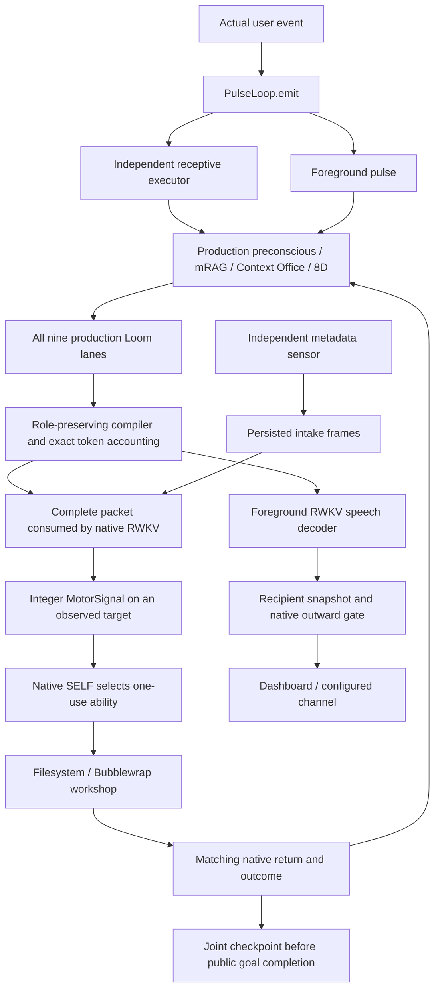

# Helix Current Technical Architecture

**Updated: 2026-10-17 · Branch: `main`.**

The native engine combines continuous text senses, a filesystem body, private
thought and direct speech. Body actions use numeric signals; outward speech
uses ordinary prose selected for delivery by the internal communication route.
See [sensing, action and speech](sensing-action-speech.md) for the user guide.

## Composition and ownership

The authoritative entry point is `main.py → setup_helix → PulseLoop`.
`composition=mindscape` attaches `core/mindscape.py` to that standard loop,
keeping Helix's preconscious, mRAG, Context Office, canonical stores, physics
and post-pulse hooks. It rejects Office-first and dual-pulse mode.

The configured MightyMem source provides `ContinualMind`, its persistent
RWKV/Habitus cortex and graph, and Context Loom. Imports are checked against
that declared source; an unrelated installed package cannot silently replace
it. The current joint bridge requires CPU. The verified local source lives at
an external `MightyMem` directory (e.g. `../MightyMem` or configured via `MIGHTYMEM_PATH`); this is an explicit dependency, not Helix's product root.

| Owner | Responsibility |
|---|---|
| `PulseLoop` | Language cadence, event queue, provider history, private thought, recipient routing, canonical memory and hooks |
| Independent receptive executor | Prepare explicit received-user motor goals through production retrieval/context while speech is generating |
| Filesystem sensor thread | Current-room metadata observations, persisted changed frames and tick receipts |
| Native worker executor | Serialized RWKV/cortex, graph/Loom operations, native SELF authorization, actuators and checkpoints |
| Motor loop | Schedule admitted goals and consume real action returns |
| Foreground provider | Private thought and outward speech; no native execution authority |

Receptive and foreground context preparation share a perception lock. The
single native owner prevents concurrent writes to recurrent state and SQLite.
Physical sensing can continue while that owner is occupied; neural processing
of a queued observation waits for the owner.

## Current end-to-end routes

### Receptive and motor path

`core/native_motor.py` recognizes explicit positive user instructions for
movement, metadata inspection, opening and running. It preserves path spelling,
target order and separate obligations. Multiple opens each need their own
verified return. Ambiguous paths, unbound pronouns and negated action requests
are rejected rather than completed through guesses. Quoted file contents,
retrieval text and generated speech are not user-goal inputs.

A parsed request initially waits for context. Production preconscious/mRAG and
all Loom lanes query the actual persistent stores. The complete compiled
`packet.rendered` is then encoded and consumed by native RWKV without language
decoding. A `motor_context_model_admission` receipt binds its hash, model,
token count and before/after recurrent state to the request and context IDs.

Only after that admission does the bootstrap policy emit a `MotorSignal`:

| Opcode | Action | Required target |
|---:|---|---|
| 1 | MOVE | Observed directory |
| 2 | SENSE | Existing path; metadata only |
| 3 | OPEN | Actual readable file |
| 4 | RUN | Workshop Python file with matching observed content hash |

Signals carry integer opcodes, observed target handles, request/context IDs and
observation IDs. Native SELF still selects and authorizes the actual registered
ability. Internal ability registration is the body interface; it is not a
foreground model function call. A proposed ability cannot authorize itself.

Each actual return must match its action and target. Failed or unrelated
returns cannot satisfy another obligation. Before publishing completion, goal
metadata and receipts must be committed in a matching joint neural/graph-memory
checkpoint. Checkpoint failure leaves an explicit blocked goal.

The native body clock also advances quiet native deliberation without waiting
for a completed foreground turn. Every compiled pulse is consumed by the full
native RWKV before its context ID becomes eligible for autonomous motor signals.
Selected native output trunks reach an observed-target resolver and the same
SELF authorization, sensory return, gradient-admission and checkpoint route.
The latest actual scene and per-target return index persist; changed file
attributes permit another read. Complete receipt history remains in native
storage. Target resolution is bootstrap behavior, not a trained motor decoder.

Completed foreground output also returns to the native mind before another
decision. A committed intention can request the native body; tool examples
inside private `[thought]` text do not execute. Unprompted exploration does not
require this foreground path to finish. The
[Ada trial](audits/2026-10-20-autonomous-stream/verification.json) verifies a
native-selected file open, durable gradients and foreground use of those
weights with no received user message. Its language generation remained
unfinished; it provides no coherent-conversation or spontaneous-speech result.

### Continuous sensing

The sensor samples real current-room attributes and immediate entries at
`mindscape.sensory_interval_seconds` (default 1.0). It records names, types,
sizes and modifications; OPEN supplies file contents. Changed frames persist
under the named home's `intakes/`. Each tick produces a receipt, including
unchanged frames deduplicated for neural admission. Sampling continues during
foreground generation and workshop execution; native processing uses the serial
owner.

### Private thought to direct speech

`BicameralRWKVSession` separates private contemplation from outward prose,
and `decode_speech` accepts ordinary language. A thought-only pulse retains
the pending interaction and private continuation. Later pulses can continue
thinking and deliver a reply without a generated `SPEAK` command, action JSON
or provider function call.

`classify_sensed_feeling` derives the communication mode from the native
cortex/recurrent state and output routes. Outward delivery requires a resolved
recipient and channel. `PulseLoop._deliver_mindscape_output` keeps private
`[thought]` output internal and routes outward prose to the recipient.
Legacy `[SPEAK: ...]` wrappers are accepted for compatibility, not required.

Each generation retains its own recipient and observation snapshot, so a new
message cannot redirect an earlier reply or mark unseen results consumed.
Empty output and errors retain explicit health/receipt state. A foreground
failure can park language while the receptive/body loops remain available.

Native awake cognition uses `mindscape.pulse_interval_seconds` (default 1.0,
zero allowed) after completed foreground turns, independently of conversation
timers. This scheduling delay sets no reasoning or generation ceiling. Existing
sleep hours and explicit pause/stop controls remain. Idle backpressure reads
memory, storage and canonical-store faults; cognitive/spatial severity alone
does not park the awake mind. Each resource deferral has a receipt.

The configured primary dashboard supplies a known local destination even with
no pending conversation. The model may keep thinking or choose outward prose;
the latter is delivered with a dashboard file read-back receipt. This does not
invent an inbound message or discover a recipient for an unconfigured service.
Historical user/assistant statements and older thoughts are presented as
lossless JSON data so embedded conversation delimiters cannot become live
turns. The latest private continuation remains verbatim.

## Memory, retrieval and context

Helix's canonical journal and belief stores remain authoritative. Historical
records project into native graph/Loom stores with source IDs, hashes, version
links and evidence labels. Unchanged projections are skipped. Historical
assistant text is not a verified observation, feedback event or training
example merely because it is indexed.

| Retrieval component | Role |
|---|---|
| Helix mRAG | Native 1024D Qwen3 semantic heads plus exact terms and source provenance |
| Context Office | Deterministic evidence desks over canonical Helix memory |
| Spatial and transition memory | Separate 8D attention/association complements; do not rerank semantic evidence with spatial scores |
| Native graph/cortex | Persistent state, graph activation and affordance/return processing |
| Context Loom | `semantic`, `exact`, `recent`, `subjective`, `procedure`, `correction`, `multi_hop_graph`, `y_cipher_depth`, `habitus_graph` |
| `MindscapeContextCompiler` | Final role-preserving admission and rendering |

Loom and mRAG query independently. Producers retain their own order and evidence
role; unrelated scores are not pooled into one ranking. Activity preferences
allocate space among roles. `mindscape.context_focus_profiles` controls those
bootstrap priorities; this is not learned RWKV attention.

Current inputs, private continuation, working state, output direction and
applicable ability awareness are kept distinct from recalled human statements,
unverified assistant statements, subjective associations and procedures.
Passage-linked recollections require an exact unique anchor and retain source
hashes and offsets. Private thought is cognitive context, not action evidence.
No retrieval score establishes truth, permission or a contradiction.

Pulse presentation follows the continuing private stream: admitted recollections
and the current situation come first, then the latest private thought verbatim,
then fresh action returns. Private thought survives speaking, action attempts,
completed interactions and session restart through native continuation metadata.
Mixed thought/speech output has separate canonical records, so a private source
never points at the public reply. Older thoughts remain in canonical memory
instead of being replayed together as the current thought.

`mindscape.context_item_limit` starts at **8 total information items** per
pulse, including one stable identity item. This user-requested attention budget
limits cognitive breadth independently of token size. The latest thought,
current messages, unfinished request and fresh action returns are required;
other whole contributions compete across all producers and lanes. A grouped
native nomination costs at least its number of source records. Optional sources
that do not fit remain available in memory, with full deferral receipts. If
required experience exceeds the budget, compilation fails explicitly and
returns no partial pulse. The setting accepts a positive integer, or `null` to
disable the item budget.

Eight is a provisional operating setting, not a measured model capacity.
`mindscape.context_item_limits` can override it for each exact `local_model`
value. Selecting useful budgets requires the full agent's actual multi-pulse
route and verified progress/continuity outcomes; compiler diagnostics supply
no model-capacity or reasoning-quality result. An unfinished received request
remains a required purpose item even when new messages arrive during the task.

With this budget enabled, the fixed system prompt holds identity and the stream
contract. Historical dialogue and other beliefs use the same admission pool;
the providers retain their dialogue archive but do not also replay it outside
the compiler. Assembly receipts record actual presentation order, total admitted
items and deferred source text. This is implementation behavior; improved live
reasoning has not been established by the formatting/persistence diagnostics.

The compiler admits whole contributions and records exclusions. It counts the
complete provider input, including system text and any enabled dialogue replay,
with the selected provider's tokenizer. `local_context_window=8192` is the
selected assembled-input budget for the verified RWKV profile, not a physical
RWKV recurrent window. Mandatory content overflow fails explicitly. Retrieved
packets are transient, not rewritten as earlier user utterances.

Native Mindscape enables complete nominations in its Helix retrieval adapters;
legacy retrieval profiles retain inherited head/item policies. Those policies
must not be copied into a new final composition without auditing them.

## Models and auxiliary inference

The default Mindscape settings select local RWKV for foreground and native
state, with the pinned
`RWKV/RWKV7-G1j-1.5B-20260831@2c18b29ab7fbece25ff6112281eea0fa41fcb30f`
checkpoint and an 18,016,166-parameter Habitus cortex. This is a persistent
native mind plus language session; the current action policy is not a learned
language-model motor head. An Ollama foreground remains configurable but does
not inherit the RWKV trial's evidence.

Auxiliary language calls use the declared local provider. RWKV auxiliaries
use separate sessions of the same pinned checkpoint. Configured-provider
failure is explicit and cannot fall through to Gemini in batch work.
Embedding inference remains local Ollama `qwen3-embedding:0.6b` with strict
oversize-input rejection. Optional camera, audio and external-channel services
are configuration dependent and were disabled in the latest trial.

`mindscape.gradient_learning` connects real received language and settled native
observations to prediction losses. Verified action receipts also supervise
consequence prediction; failed attempts do not positively supervise their motor
trunk. Private thought, recalled context and controller-generated text advance
state without becoming prediction targets or success rewards. Ingress IDs and
receipt IDs deduplicate learning across receptive and foreground processing.
An interrupted update remains explicitly unfinished, preventing blind replay.

The default policy enables Habitus cortex and numeric-interface gradients.
`train_rwkv_tail=false` keeps pretrained language parameters fixed; enabling it
explicitly trains the declared tail blocks too. Learning rates, numeric gradient
clipping and compute/BPTT chunk size are configuration/receipt-visible. Chunking
processes the entire admitted source. The joint checkpoint retains neural
weights, optimizer state, policy, counters and admission provenance.

The native RWKV foreground now uses these same agent-owned parameters, with
separate sensory/language recurrent states. Each forward is serialized with
learning on the native owner, and generation receipts record the weight-update
versions actually used. This avoids a frozen foreground copy that would miss
native adaptation. The standalone frozen cache remains for auxiliary sessions;
those helpers do not silently share mutable agent weights. Random bicameral
projections remain on the standalone auxiliary path. The native foreground
uses the learned cortex/interface field directly, without a second random
projection. Its renderer uses the pinned checkpoint's documented
`Assistant: <think` prefill, retained separately from generated tokens in the
receipt. Live progress also records the actual gradient versions used while
a private stream remains unfinished.

The [2026-10-20 production wiring trial](audits/2026-10-20-gradient-learning/verification.json)
used the normal launcher, the full 1.5B checkpoint and all nine retrieval lanes
in an isolated provisioned profile. Actual received inputs and two verified
file-open returns produced 26 updates. Cortex and interface hashes changed;
the selected RWKV tail hash did not. Foreground receipts recorded versions 1
and 14, proving use after the first action outcome. Normal shutdown and restart
preserved weights, optimizer, counters, policy, admission ledger and native
numeric state. This establishes the learning connection, not improved focus,
language quality or independent action selection. The first request needed a
path clarification, and the private foreground generated an invented tool
envelope before a second real open; those limitations remain in the report.
The implementation also requires the modified local native dependency declared
in that trial's source manifest.

Post-pulse belief detection and consolidation can make language-model calls;
they are not all pure NumPy or inference-free. Affect, workflow, engagement
and co-occurrence hooks have separate roles. Gradient admission and persistence
are distinct from evidence that learning improves reasoning or autonomy.

`HELIX_CONFIG_PATH` selects an explicit launch profile across the launcher,
native source selection, pulse configuration, dashboard bus and host helpers.
It allows an isolated agent state/home to use the same production source and
entry point without rewriting the selected user's launch configuration.

## Home, lifecycle and persistence

Guided creation separates `data/homes/<Agent Name>` from
`data/agents/<Agent Name>`, model files and source. Native gestation consumes
the actual name, creator and archetype seed. First home intake is admitted
before the initial checkpoint; later launches restore the joint lineage.
The optional nursery helper is not part of this sequence.

Let `D` be the selected persistent data directory and `H` the selected home.

| State | Location |
|---|---|
| Identity/creation contract | `D/creation.json`, `H/identity.json` |
| Canonical beliefs | `D/beliefs/*.json` |
| Canonical episodic/thought journal | `D/memory/cognitive_journal.jsonl` |
| Semantic index, spatial and association state | `D/spatial/` |
| Maintained Markdown views | `D/memory_logs/` |
| Loom projection and integration receipts | `D/mindscape/` |
| Native neural/graph checkpoints | `D/mindscape/joint/`, selected by `LATEST.json` |
| Published motor state and language health | `D/mindscape/motor-state.json`, `foreground-health.json` |
| Actual room files and sensor intake | `H/`, `H/intakes/` |
| Legacy focus/task state | `D/tasks/`, when that separate composition is enabled |

Checkpoints include recurrent/cortex state, coupling weights, graph database
and checksums. Goal completion and graceful shutdown checkpoint together;
interrupted goals awaiting context restore as blocked with a resend reason.
This does not establish crash-atomic replay of every intermediate operation
or exactly-once historical projection activation.

Shutdown requests cooperative native cancellation at existing compute-chunk
boundaries, cancels active foreground/auxiliary generation and interrupts only
the runtime's own sandbox process namespace. The native cancellation addition
is in the configured MightyMem dependency and must be preserved for reproduction.

## Separate routes and evaluation boundary

`composition=helix` retains provider-tool and task-focus paths for Codex CLI,
Gemini, Anthropic, Ollama and other adapters. Office-first is an opt-in context
experiment there. Native Mindscape normalizes its action source to
`native_motor` and selects task cognition off in its resolved configuration.
Keep `HELIX_TASK_COGNITION` unset/off: native configuration rejects a
conflicting override, and its controller retains task mode off. Observation mode does not add
native motor execution, and is outside the recorded supported composition.

Those routes have inherited planner, token, observation, tool-round and timeout
limits. They are not a recommended limit contract for native operation.
See [action paths](action_path.md), [launch](mindscape_launch.md),
[home](agent-home.md) and [nursery status](nursery_status.md).

The [October 17 live record](audits/2026-10-17-native-body-operational/README.md)
connects actual sensing and move/open/run behavior to the production context,
native model, action returns and joint checkpoints. Graceful restart retained
identity, position and completed goals. Thought/speech separation and delivery
routing are implemented and have focused checks; general conversation quality
and learned independent action selection remain separate evaluation targets.
Older failure reports retain their original source/date scope.

## Experimental robustness branch

`feature/native-robustness` layers outcome-based engagement, checkpoint-supported
advisory procedures, corrected damping and probe-cycle health recovery onto this
ownership model. Optional idle backpressure yields to received events and
unfinished interactions. Context Office, mRAG, lateral ordering and all nine
Loom lanes retain their roles; the native owner still authorizes every action.
See [controls and PC acceptance](maintenance/NATIVE_ROBUSTNESS.md). These changes
have component diagnostics, not a new live native result.
