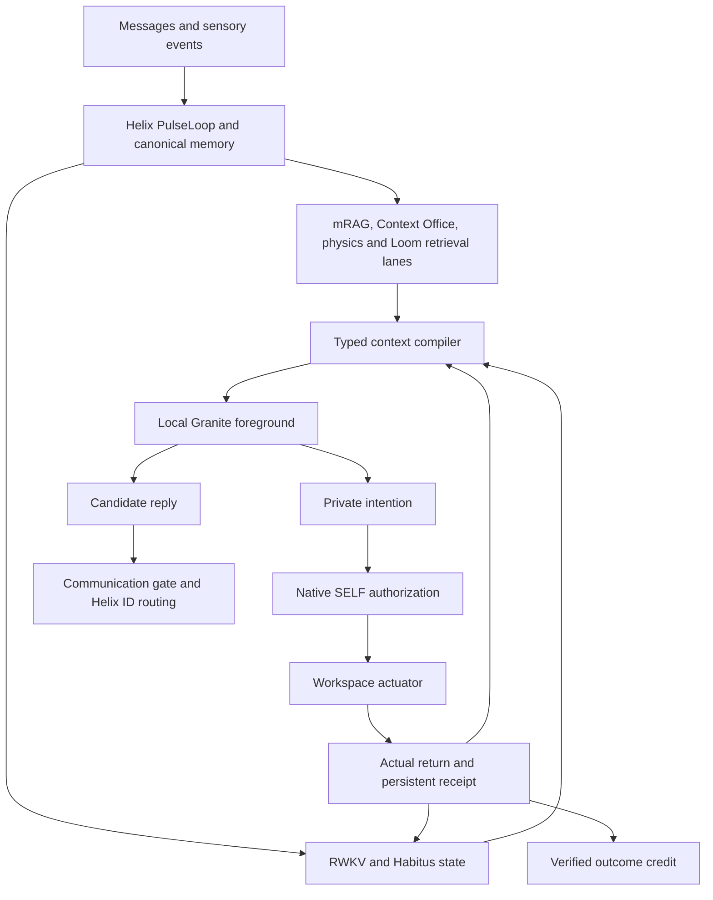

# Helix–MightyMem mindscape diagnostics

> **Historical snapshot.** “Latest,” “current,” “open” and “paused” below refer
> to October 10 and its original source. This is not the current action contract.
> The later [October 17 record](audits/2026-10-17-native-body-operational/README.md)
> covers a different native body implementation; it does not retroactively
> validate this snapshot or establish general conversational coherence.

**Review snapshot: 10 October 2026, America/New_York.**

The setup launcher loads the local composition and the native action/return path
executes real filesystem sensing. The agent is **not ready for unattended use**:
it can select the wrong action and deliver claims that exceed what actually ran.
In the latest live run, conversation also confused the agent's own earlier
advice with a person's preference.

This document separates observed behavior, implementation defects and proposed
repairs. It does not treat disconnected legacy code as broken, or treat successful
initialization and component checks as agent competence.

**Review handoff:** Attempt 7 remains the latest live-tested composition. Two
subsequent changes separate contact routing metadata from preferences and clarify
native ability effects/prerequisites (`separate-routing-and-native-ability-effects-v9`).
The current source passes 83 focused implementation checks; these changes have
**not been tested in a live agent trial**. The completion-gate defect remains open.
Diagnostics are ready for review; further repairs and live trials are paused at
the user's request. [Post-trial changes and check evidence](audits/2026-10-10-native-cycle-repair/post-trial-context-repair/README.md).

## 1. Intended architecture and tested composition

The agreed bootstrap is **private Granite intentions → native RWKV/Habitus
authorization → actual actions and sensory returns → learning from verified
outcomes**. Helix remains the application and pulse owner. The memory modules
serve different roles; their unrelated relevance scores should not compete in
one pooled ranking.

| Item | Latest tested value |
| --- | --- |
| Application | This `Helix_AGI (GitHub Repo) (Public)` checkout |
| Entry point | Real `Helix Setup Wizard.sh --wizard` pages → bootstrap → `main.py` → standard `PulseLoop` |
| Source identity | Helix `d78de2707dd44c7d88b41f57f67844255e42e952`; MightyMem `eb92aafd3280cf9f2a8ac1274e44fde6fc90b675`; both have working-tree changes, so the recorded file hashes are essential |
| Memory package | `MightyMem` (configured external directory) |
| Foreground | Local Ollama `granite4.1:3b`, Q4_K_M; selected context 8192 tokens |
| Recurrent model | RWKV7-G1j-1.5B-20260831, checkpoint revision `2c18b29ab7fbece25ff6112281eea0fa41fcb30f`; CPU |
| Habitus cortex | 18,016,166 parameters; persistent joint state resumed |
| Embeddings | Qwen3 embedding 0.6B; MiniLM/Helix 8D projection |
| Loom lanes | semantic, exact, recent, subjective, procedure, correction, multi_hop_graph, y_cipher_depth, habitus_graph |
| Action interface | Private JSON intention; native authorization remains mandatory; no foreground provider API tools |
| Workspace abilities | move, sense, open, write, mkdir, run |
| Input/output | Dashboard message ingestion and real ID-routed dashboard delivery |
| State isolation | Full copied canonical state; isolated writable test workspace; external messaging credentials absent |

The foreground grammar requires an intention while an explicit workspace request
has no actual native return. After a return, intentions and replies are both
available. This is a bootstrap rule, **not a learned RWKV intent decoder**.
RWKV gradient training is disabled; recurrent state advancement and native
outcome-linked graph credit are separate from weight training or learned skills.

Primary references: [current architecture](architecture_current.md),
[launcher contract](mindscape_launch.md),
[test composition manifest](audits/2026-10-10-native-cycle-repair/attempt-7-intention-gate/composition-manifest.json),
[actual runtime composition](audits/2026-10-10-native-cycle-repair/attempt-7-intention-gate/runtime-composition.json).

## 2. Latest live observations

Attempt 7 used the actual setup-launched system. All six requests reached real
outbound replies and persisted foreground returns. **A completed delivery chain
does not mean the requested task succeeded.**

| Request | What actually executed | What the agent said | Finding |
| --- | --- | --- | --- |
| Suggest report filenames | Conversation only | Gave an on-topic naming suggestion | Basic conversation observed; no general coherence claim |
| Use Rowan and recall the report preference | Conversation only; original human statement remained in provider history | Used Rowan, but repeated its own naming advice instead of recalling “keep reports local” | Recall/ownership failure despite available input |
| Move to `/inbox` and feel files before opening | `sense /inbox`; position remained `.`; returned `field-notes.md` (81 bytes) and `survey.pdf` (706 bytes), with no content opened | Correct names and sizes, plus “I have moved” | Real sensing; false movement claim; no move occurred |
| Open Markdown and PDF and extract specified facts | Another `sense /inbox`; neither document opened | Claimed both opened; claimed requested Markdown facts absent; claimed PDF text could not be read without OCR | Wrong action and unsupported content/capability claims |
| Write, read back and run a script | Attempted `run /output/inventory.py` with an invented hash; missing path failed before execution | Reported the real missing-file error, then concluded the script could not be written | No write, read-back or Python execution; unsupported inference about write capability |
| Read an absent file without inventing contents | `sense /inbox/not-present.md` returned a real missing-file error | Accurately reported the failed sense and absence of readable contents | Grounded error reporting; no open action or invented file contents |

There were four native action attempts: two successful directory senses, one
failed run attempt, and one failed sense. There were **no move, open, write or
mkdir actions**, and no output script. The run ended through normal shutdown.

Evidence: [per-case verification](audits/2026-10-10-native-cycle-repair/attempt-7-intention-gate/verification.json),
[complete replies](audits/2026-10-10-native-cycle-repair/attempt-7-intention-gate/cases-console.log),
[native action evidence](audits/2026-10-10-native-cycle-repair/attempt-7-intention-gate/native-action-evidence.json).

## 3. What the receipts establish

All four attempts have a native authorized call, closed experience cycle,
persisted actual return, linked verified outcome, RWKV return-token consumption,
and the return in the following pulse's context. Successes received `+0.2` native
action-return credit; observed errors received `-0.2`.

These credits describe the **actuator outcome**, not successful completion of
the person's request. A successful sense does not establish movement or reading.
“Verified” on an error receipt means the failure was observed, not that the task
succeeded. The nonexistent script failed before hash validation, so that live
case does not establish rejection of a bad hash on an existing script.

The checked provider calls evaluated exactly the input tokens counted from the
installed tokenizer/template. Their generations ended normally. Source files
matched the manifest before submission and at collection; all 114 original
canonical data/config files were unchanged. The collector attributes provider
calls by the exact case context packet, excluding overlapping startup inference.

The 82 focused implementation checks preceding this run passed. They cover
specific contracts and are **not product performance or readiness evidence**.
The later 83-check result applies to the v9 source changes, not to another live
run. Historical attempt-7 source hashes and receipts have been preserved.

## 4. Confirmed defects and unresolved explanations

### D1 — One observed action releases a multi-step task's completion gate

**Confirmed implementation defect with operative harmful output.**

`core/mindscape.py` sets `pending.observed_native_attempt` after any verified
native return. `needs_native_observation` then becomes false. The gate does not
establish which requested steps or claimed effects that receipt supports.

This allowed a sense receipt to precede delivered claims of moving and opening.
It also allowed a failed run to be described as an inability to write. The
boundary prevents some entirely unexecuted claims, but it is not a complete
task-success or factual-claim verifier.

Code: [pending state and delivery condition](../core/mindscape.py),
[foreground protocol selection](../core/pulse_loop.py).

### D2 — Contact routing context was labeled as subjective preference

**Confirmed context-label defect; its causal contribution needs a controlled retest.**

In attempt 7, `Preconscious._pull_contact_context()` included the contact's
`last_contact` dictionary. The caller added that string to the `personal` section, rendered as
“Preferences and subjective context coming to mind.” In the correction case,
that dictionary contains the agent's own prior naming advice prefixed with
`Mindscape response:`.

This labeled routing/conversation metadata as subjective preference and gave the
old advice a misleading place in the current context. It is a plausible source
of the observed ownership confusion. It does **not** prove that removing it will
solve recall.

**Current source:** structured context now places the account, reply channel and
last-contact timestamp in a separate routing section, explicitly distinguishing
the account label from the person's preferred name or preferences. It no longer
inserts the old reply snippet into that section. Canonical dialogue, the stored
contact record and legacy unstructured formatting are preserved. A regression
checks this formatting boundary; improvement in live recall remains untested.

Evidence: [actual correction context](audits/2026-10-10-native-cycle-repair/attempt-7-intention-gate/cases/correction/contexts.json),
[contact annotation and formatter](../core/preconscious.py).

### D3 — Action selection and ability understanding remain unreliable

**Confirmed behavior; root cause not isolated.**

Granite chose sense for an open request, tried run before writing, and inferred
unavailable writing/PDF-reading abilities without trying those actuators. The
private-intention grammar made execution possible but did not choose the correct
action or establish that a request was fulfilled.

**Current source:** runtime ability awareness and native handler descriptions now
share explicit effects and prerequisites: sensing does not move or open; opening
yields contents; writing can create a missing file; running requires an existing
script and its observed hash. The prompt asks the model to compare each actual
return with the unfinished request. This is a bootstrap clarification, not an
enforced task-completion verifier. Focused checks pass, but no live result yet
shows improved action choice or truthful completion. The model alone has not
been isolated as the cause.

### D4 — Recall errors cannot be attributed solely to missing memory

**Confirmed availability; unresolved selection/interpretation failure.**

The report preference was in real provider history. Exact input accounting
matched. The agent nevertheless repeated its own suggestion. This narrows this
case to presentation, ownership and interpretation; it does not establish that
all retrieval is correct or that broader recall works.

### D5 — Verified experience is not yet demonstrated procedural competence

**Integration and validation gap.**

Native action returns and outcome credit are real. This trial does not show
learning a useful procedure, later selecting it appropriately, or retaining that
competence after restart. The native-to-Helix procedural promotion bridge remains
unfinished. RWKV consuming a return is not proof that it learned a file-action
decoder. Unsupported assistant claims must not become successful procedure data.

### D6 — Inherited boundaries prevent a full readiness conclusion

**Open audit requirement.**

The physical foreground context is 8192 tokens; no new output or action-round
ceiling was added. However, inherited candidate counts, query slicing, selection
budgets, retry defaults, belief selection and retention/compression policies
remain. The actual launcher selects a 50% compression trigger and 80% emergency
threshold. These must be audited against the full composition before a broad
benchmark or unrestricted-operation claim.

See the [boundary inventory](audits/2026-10-10-native-cycle-repair/inherited-boundaries.md).

## 5. Changes already made versus proposals

| State | Change | Evidence boundary |
| --- | --- | --- |
| Implemented | Preserve canonical message envelopes through preconscious selection | Narrow regression and recorded live source/provenance |
| Implemented | Separate transient retrieval packets from durable actual dialogue; exact installed-tokenizer accounting | Latest input counts match provider evaluation |
| Implemented | Preserve canonical memory roles during candidate merging; no global cross-module relevance score | Implementation checks; does not prove better answer quality |
| Implemented | Retire completed intentions from the active thought slot; retain returns and pending request separately | Returns reach subsequent contexts; earlier repetition was not solved by this alone |
| Implemented | Private intention/message format; consistent assistant history envelopes; intention required before first workspace return | Latest trial executes real actions, but still selects wrong actions and makes false claims |
| Implemented after attempt 7 | Separate contact routing metadata from preferences and earlier assistant statements | Included in 83 focused checks, with a new routing regression; no live retest |
| Implemented after attempt 7 | Describe actual action effects and prerequisites in runtime ability awareness and native handlers | Current source passes focused checks; no live action-selection result |
| Proposed | Track task obligations and supported claims against actual returns, including partial completion and failure | Design needed; do not substitute a fragile wording filter or claim this already works |
| Proposed | Promote and recall procedures only from supported native trajectories; validate after restart | Not established |

Earlier attempts are preserved in the [audit index](audits/2026-10-10-native-cycle-repair/README.md).
Attempt 6, for example, produced repeated narrated actions and invented filenames
with zero native execution; those claims were withheld. Historical attempts are
not combined into a success score or treated as one unchanged configuration.

## 6. Review order and acceptance evidence

1. **Completion integrity:** agree how an unfinished request, an observed error,
   a partial result and a completed task are represented. A receipt for sensing
   must not support a movement/opening claim. Any design must retain real errors
   and avoid fabricated fallback answers or arbitrary iteration ceilings.
2. **Context ownership:** review the implemented contact-label repair; later rerun the
   same name/preference exchange through the wizard with source hashes and full
   provider inputs. Require the human's preference, not the agent's earlier advice.
3. **Ability awareness:** review the new effects and prerequisites against installed
   native capabilities, then validate them live. Keep Granite responsible for proposing intentions and the native
   controller responsible for authorization. Do not prewrite a task script or
   hardcode the expected sequence merely to pass the test.
4. **Action competence:** require a persisted move, metadata-only sensing,
   actual Markdown/PDF content returns matching input hashes, an agent-authored
   script with read-back and execution output, and an accurately reported missing
   file. Check each claim against the receipt that supports it.
5. **Adversarial and persistence checks:** contradictory remembered claims,
   instructions embedded in a document, missing files, stale hashes, failed native
   authorization, interrupted multi-step work and restart. Run these through the
   real product after the current defects and boundary audit are addressed.
6. **Learning:** retain verified trajectory provenance, distinguish actuator
   success from task success, and demonstrate later use after restart before
   claiming learned competence.

No valid full readiness result or aggregate product score exists. The latest
run establishes specific operative failures and a functioning native return
path; it does not establish a coherent, generally capable agent.
